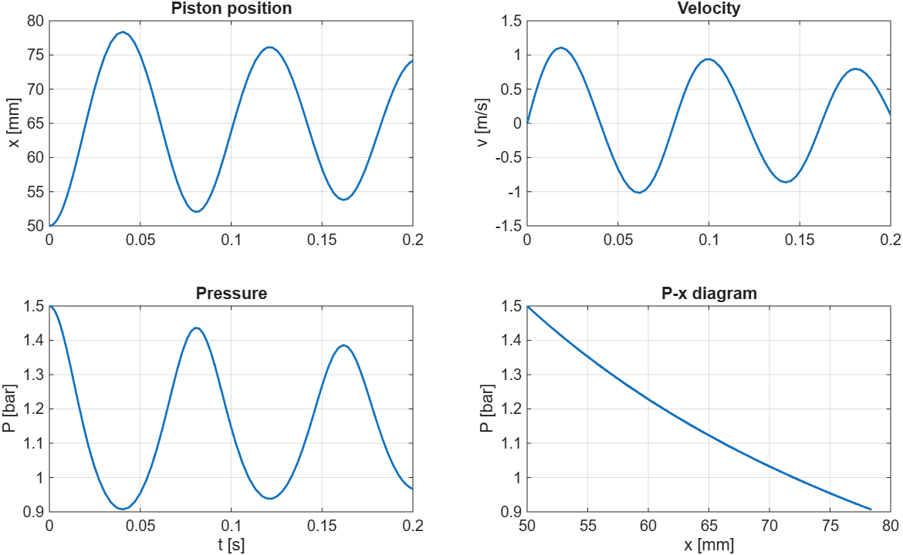

# ODE and DAE Solver Demo

Custom explicit and implicit solvers for ordinary differential equations (ODEs) and a simple index-1 differential-algebraic equation (DAE). The script demonstrates practical numerical methods for dynamic systems, with emphasis on stiff problems, constraint stabilization, and reduced-order modeling suitable for real-time control.


**File:** `A3_ode_dae_solver_demo.m`

## Overview

The demo contains three examples:

1. **Robertson chemical kinetics** — classic stiff ODE requiring an implicit method (Backward Euler with Newton iteration).
2. **Simple index-1 DAE** — pendulum in Cartesian coordinates with algebraic length constraint, solved with explicit Euler plus projection.
3. **Reduced-order linear generator model** — three-state toy model of a free-piston / linear generator cycle, illustrating a real-time capable ODE system for controls.

All examples run in pure MATLAB (no external toolboxes required beyond base functionality). The script prefers `ode45` when available and falls back to a fixed-step RK4 otherwise.

## Requirements

- MATLAB R2016b or later (tested with base MATLAB)
- No additional toolboxes needed

## Usage

```matlab
% From the MATLAB command window or editor:
A3_ode_dae_solver_demo
```

The script prints progress messages and generates three figures:

- Robertson problem (semilog concentration plots)
- Pendulum DAE (trajectory + constraint length)
- Linear generator ROM (position, velocity, pressure, and P–x diagram)

## Example 3: Reduced-Order Linear Generator Model

This section implements a simplified free-piston linear generator suitable for control-oriented simulation. The model has only three states and can be integrated far faster than real time.

### Parameters

| Symbol     | Value   | Unit | Description                     |
|------------|---------|------|---------------------------------|
| m_piston   | 5       | kg   | Piston mass                     |
| A_p        | 0.01    | m²   | Piston area                     |
| V_clear    | 1e-4    | m³   | Clearance volume                |
| k_spring   | 1e4     | N/m  | Gas-spring stiffness            |
| c_damp     | 20      | Ns/m | Viscous damping                 |
| P_atm      | 1e5     | Pa   | Atmospheric pressure            |
| gamma_g    | 1.3     | –    | Effective polytropic exponent   |

### State Vector

```
y = [x; v; P]
```

- `x` — piston position (m)
- `v` — piston velocity (m/s)
- `P` — chamber pressure (Pa)

Initial condition: mid-stroke, at rest, 1.5 bar  
`y0 = [0.05; 0; 1.5e5]`

### Governing Equations

**Mechanical (Newton’s second law):**

```
m * dv/dt = (P - P_atm)*A - k*(x - 0.05) - c*v
```

**Thermodynamic (polytropic process with heat addition):**

```
dP/dt = (gamma-1)/V * Qdot - gamma * (P/V) * (A * v)
```

where volume `V = V_clear + A * x`.

Heat release is a simple Gaussian pulse that fires only near top-dead-centre (`|x| < 0.01`) and while the piston is moving inward (`v < 0`). The pulse amplitude is illustrative only.

### Key Modeling Simplifications

- Single chamber + linear gas spring (instead of opposing pistons or bounce chambers)
- Open-loop heat-release pulse (no combustion chemistry or heat transfer)
- Electrical generator load absorbed into the constant damping coefficient
- No leakage, friction maps, or valve dynamics

These choices keep the model to three ODEs that evaluate in microseconds, making it suitable for model-predictive control, observers, or hardware-in-the-loop simulation. A production model would replace the toy heat-release law with a more physics-based combustion description and couple the mechanical side to a proper electromagnetic force map while preserving the low state dimension.

## Notes on the Other Examples

- **Robertson problem**: Explicit RK4 fails or requires extremely small steps. The demo uses Backward Euler with a simple Newton solver.
- **Pendulum DAE**: Demonstrates a stabilized index-1 formulation with velocity-level constraint and simple projection back onto the manifold after each explicit Euler step. Constraint drift remains small over the short simulation horizon.

## Key Takeaways

- Stiff systems need implicit methods (BDF, Rosenbrock, or simple Backward Euler as shown).
- DAEs require consistent initialization and some form of index reduction or stabilization.
- Real-time control simulation benefits from reduced-order models that run much faster than wall-clock time.

## License

This demo code is provided for educational and research use. Adapt and extend as needed for your own projects.

---

*Generated as a companion document to the discussion of the linear-generator reduced-order model section.*
